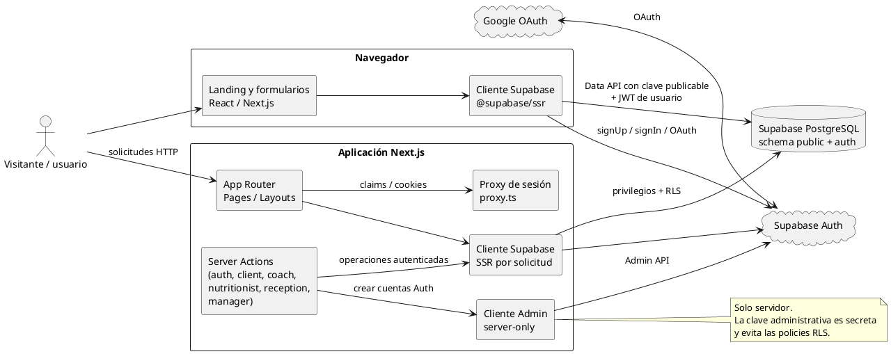
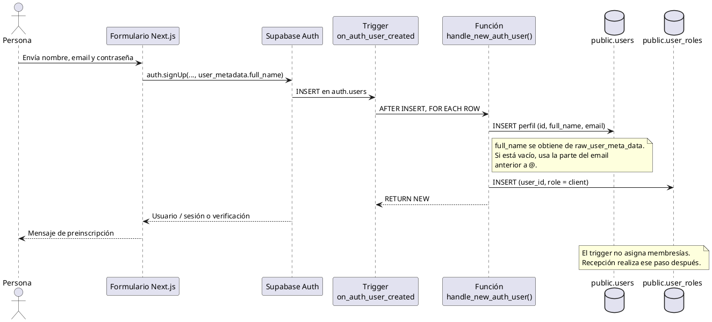
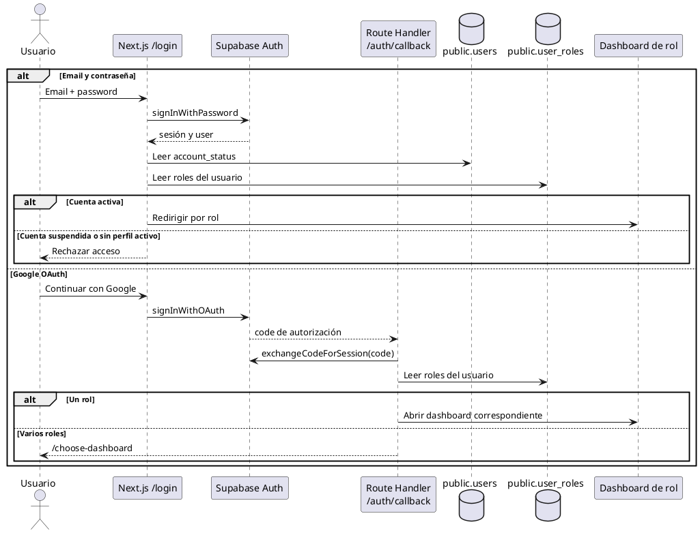
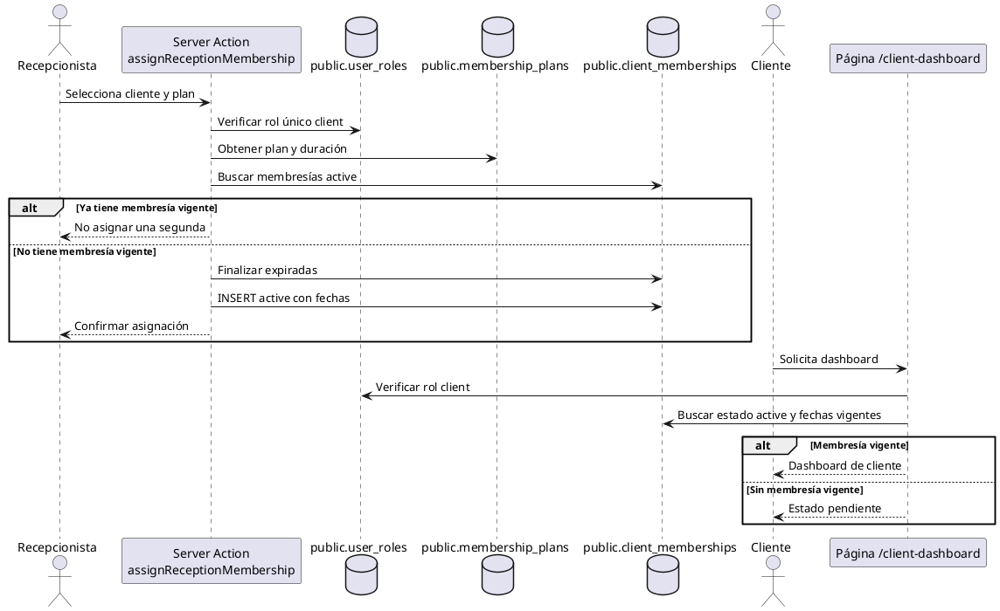
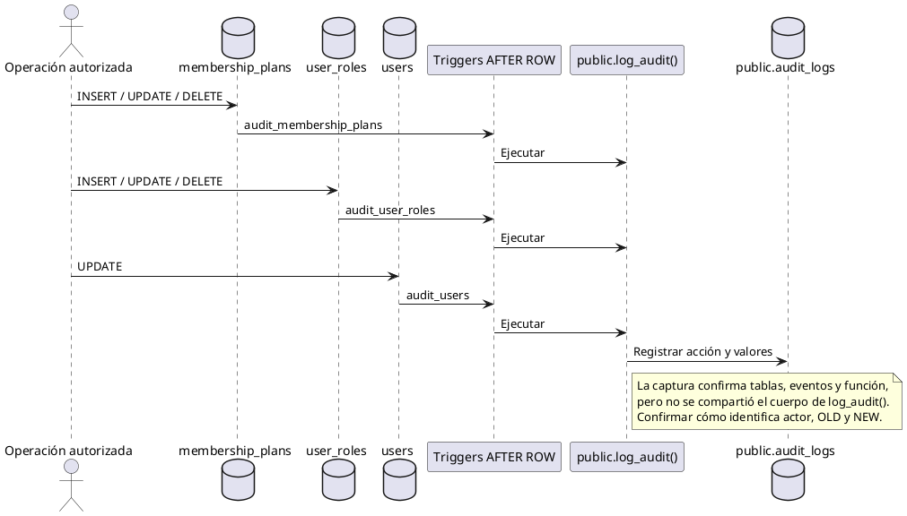
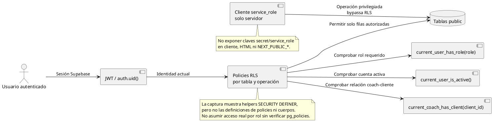
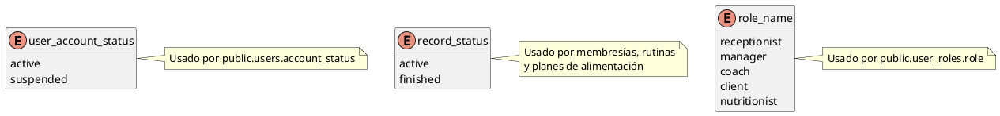

# Diagramas PlantUML de VibeFit

Documento auxiliar con código PlantUML editable para que los diagramas se
rendericen manualmente. **No contiene imágenes generadas.** Los bloques
representan la arquitectura y el esquema descritos en
[`ARQUITECTURA_VIBEFIT_ES.md`](./ARQUITECTURA_VIBEFIT_ES.md).

## 1. Arquitectura de componentes

## 2. Modelo entidad-relación

```plantuml
@startuml VibeFit_ERD
hide circle
skinparam linetype ortho
skinparam entity {
  BackgroundColor #FAF9FC
  BorderColor #4B5563
}

entity "auth.users" as auth_users {
  * id : uuid <<PK>>
  --
  email : text
  raw_user_meta_data : jsonb
}

entity "public.users" as users {
  * id : uuid <<PK, FK auth.users>>
  --
  full_name : varchar
  email : varchar <<UNIQUE>>
  account_status : user_account_status
  created_at : timestamptz
  updated_at : timestamptz
}

entity "public.user_roles" as user_roles {
  * user_id : uuid <<PK, FK users>>
  * role : role_name <<PK>>
  --
  assigned_by_user_id : uuid <<FK users>>
  assigned_at : timestamptz
}

entity "public.membership_plans" as membership_plans {
  * id : uuid <<PK>>
  --
  plan_name : varchar <<UNIQUE>>
  price : numeric
  duration_in_days : integer
  created_at : timestamptz
}

entity "public.client_memberships" as client_memberships {
  * id : uuid <<PK>>
  --
  client_user_id : uuid <<FK users>>
  membership_plan_id : uuid <<FK membership_plans>>
  assigned_by_user_id : uuid <<FK users>>
  start_date : date
  end_date : date
  membership_status : record_status
}

entity "public.attendance_records" as attendance_records {
  * id : uuid <<PK>>
  --
  client_user_id : uuid <<FK users>>
  registered_by_user_id : uuid <<FK users>>
  attended_at : timestamptz
}

entity "public.daily_logs" as daily_logs {
  * id : uuid <<PK>>
  --
  client_user_id : uuid <<FK users>>
  log_date : date
  weight_kg : numeric
  sleep_hours : numeric
  calories_consumed : integer
  calories_burned : integer
  created_at : timestamptz
}

entity "public.fitness_tracker_test_details" as test_details {
  * id : uuid <<PK>>
  --
  client_user_id : uuid <<FK auth.users>>
  log_date : date
  workout_type : text
  workout_duration_minutes : integer
  steps_count : integer
  sleep_quality : text
  calories_per_minute : numeric
  day_name : text
  activity_category : text
}

entity "public.client_coach_assignments" as coach_assignments {
  * coach_user_id : uuid <<PK, FK users>>
  * client_user_id : uuid <<PK, FK users>>
  --
  assigned_at : timestamptz
}

entity "public.routines" as routines {
  * id : uuid <<PK>>
  --
  coach_user_id : uuid <<FK users>>
  routine_title : varchar
  routine_description : text
  created_at : timestamptz
  updated_at : timestamptz
}

entity "public.routine_days" as routine_days {
  * id : uuid <<PK>>
  --
  routine_id : uuid <<FK routines>>
  day_number : smallint
  day_title : varchar
  exercises_details : text
}

entity "public.routine_assignments" as routine_assignments {
  * id : uuid <<PK>>
  --
  routine_id : uuid <<FK routines>>
  client_user_id : uuid <<FK users>>
  assignment_status : record_status
  start_date : date
  end_date : date?
}

entity "public.meal_plans" as meal_plans {
  * id : uuid <<PK>>
  --
  client_user_id : uuid <<FK users>>
  nutritionist_user_id : uuid <<FK users>>
  plan_details : text
  start_date : date
  end_date : date?
  meal_plan_status : record_status
}

entity "public.audit_logs" as audit_logs {
  * id : uuid <<PK>>
  --
  changed_by_user_id : uuid <<FK users>>
  entity_name : varchar
  entity_id : varchar
  action_performed : varchar
  previous_values : jsonb?
  new_values : jsonb?
  changed_at : timestamptz
}

auth_users ||--|| users : "perfil"
users ||--o{ user_roles : "roles"
users ||--o{ user_roles : "asignado por"
membership_plans ||--o{ client_memberships : "plan"
users ||--o{ client_memberships : "cliente"
users ||--o{ client_memberships : "asignó"
users ||--o{ attendance_records : "cliente"
users ||--o{ attendance_records : "registró"
users ||--o{ daily_logs : "seguimientos"
auth_users ||--o{ test_details : "detalles de prueba"
users ||--o{ coach_assignments : "coach"
users ||--o{ coach_assignments : "cliente"
users ||--o{ routines : "crea"
routines ||--o{ routine_days : "días"
routines ||--o{ routine_assignments : "asignada"
users ||--o{ routine_assignments : "cliente"
users ||--o{ meal_plans : "cliente"
users ||--o{ meal_plans : "nutricionista"
users ||--o{ audit_logs : "actor"

note bottom of test_details
El dump compartido apunta este FK a auth.users.
Confirmar contra Supabase si debería apuntar a public.users.
end note

note bottom of routine_assignments
El índice parcial compartido es único por
(routine_id, client_user_id) para estado active.
No asegura por sí solo una sola rutina activa
entre todas las rutinas de un cliente.
end note
@enduml
```

## 3. Registro de usuario y trigger de perfil/rol

## 4. Autenticación y selección de dashboard

## 5. Asignación de membresía y acceso del cliente

## 6. Auditoría por triggers

## 7. RLS y funciones auxiliares

Este diagrama describe los componentes de autorización observados y los
límites que deben imponerse. No representa policies concretas, porque no se
compartió el inventario de policies del proyecto.

## 8. Tipos y restricciones representados

## Notas para renderizar

- Cada bloque es una fuente PlantUML independiente y puede copiarse a un
  archivo `.puml`.
- Los diagramas no son imágenes incrustadas ni se renderizan automáticamente.
- El ERD muestra las claves foráneas informadas. Las discrepancias de índices,
  constraints y la FK de `fitness_tracker_test_details` están anotadas para
  evitar dar por válido un esquema ambiguo.
